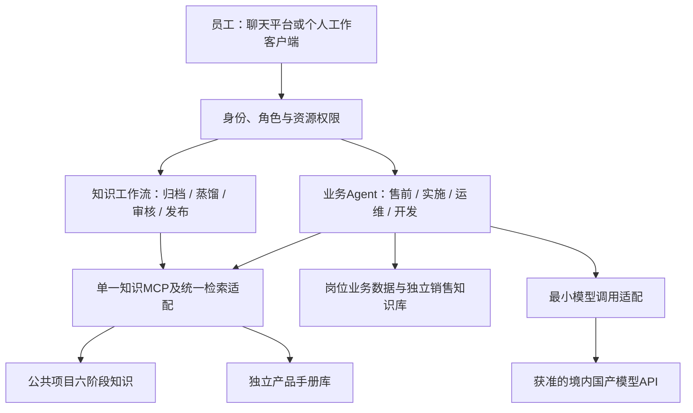

# 公司知识与业务智能体：产品需求规格

文档版本：2.0｜产品与架构基线：2026-10-26｜当前知识 MCP 代码版本：1.5.6。

本文是全产品的唯一产品基线，涵盖现有原件、蒸馏与 RAG，以及规划中的售前、实施、运维、开发 Agent。文档版本不表示应用代码已经升级。技术实现见 [02](02-总体架构与开发文档.md)，业务交互见 [03](03-业务Agent产品与开发方案.md)。公司模型代理及其授权、用量和公司对话管理已移出本项目，独立管理。任务状态统一维护于[产品迭代看板](产品迭代看板.md)，迭代同步规则见[项目记忆](项目记忆.md)。

## 1. 定位、目标与产品结构

建设公司知识与业务智能体体系：以可追溯、可按版本读取的公司知识支持日常工作，以业务 Agent 整理事实、提出建议、推进确认。第一阶段主线为明确 Agent 平台选型、建设最小公共底座、开发售前 Agent 首个功能闭环。

首个业务应用是企业微信中的售前 Agent。首期先解决一个完整销售场景：检索公司知识 → 形成客户画像 → 分析并讨论确认需求 → 生成可供销售审阅修改的售前方案。以同一客户场景的完整产物验收，销售记录、商机管理、跟进、提醒与周报后续逐步完善。实施、运维、开发 Agent 共享基础能力，分别按岗位工作流程规划。

产品由接入与身份、知识生产与检索、岗位 Agent、业务数据与记忆以及最小模型调用适配组成。Agent 平台经本地最小兼容验证选定 Spring AI Alibaba Agent Framework/Graph 1.1.2.2，接续建设公共底座与售前闭环；既有 Python 单知识 MCP 保留，业务尚未实现。公司销售业务事实使用结构化数据库保存。Dify 不纳入本项目架构。详见[开源方案候选](06-开源方案候选与评估维度.md)。

## 2. 当前开发状态

以下为 2026-10-26 的状态快照；具体证据见 [07](07-单MCP本地RAG开发与黑盒验收.md)，不是本轮重新运行测试所得。

| 能力 | 当前状态 | 对应看板 | 说明 |
| --- | --- | --- | --- |
| 原件、Word 蒸馏、正文与 sidecar、来源和评分 | 本地已实现并有客户端验收记录 | K01–K04 | 上传不解析、不蒸馏、不索引；Word 外格式不参与蒸馏 |
| 图形结构独立存储、分节索引、同版补读、按需图形读取 | 本地已完成 | K05–K08 | 本地适配及规定场景通过；不等同于公司文件服务器 |
| 撤回知识版本 | 本地黑盒验收已完成 | K09 | 停止默认命中、拒绝读取并保留历史 |
| 产品手册独立库、目录质量提示、图号或位置回取原图 | 本地真实 Word 验收已完成 | K10–K11 | 当前限规范 Word 产品手册；不解析图片语义，不另存图片副本 |
| 培训资料多格式、PDF 蒸馏 | 需求讨论 / 暂停 | K12 / K13 | 当前不支持；PDF 恢复需明确安排 |
| RAG 与其他 Agent 应用优化 | 后期统一优化，尚未开展 | K14/K25 | 最后优化类别单独排期，不与第一阶段开发并行；必要正确性验收保留在原开发任务 |
| 售前业务 Agent | 第一阶段待开发，尚未实现 | K15 | 企微首发，知识/画像/需求/详细方案闭环及人工业务验收；销售管理后置 |
| 公司文件服务、远程认证与生产发布 | 暂停 | K16 | 保留原暂停决定；本次仅规划，不恢复实施 |
| Agent 公共基座及实施、运维、开发 Agent | 规划，尚未实现 | K17–K20 | Java 平台已在隔离探针完成技术验证；正式底座和岗位 Agent 尚未编写，现有依赖中的 LangGraph 不作为新业务运行平台 |
| Agent 平台选型 | 已完成本地最小选型验证及定案 | K24 | Spring AI Alibaba 1.1.2.2；真实模型及本地 MCP/恢复证据见 06；企微及完整业务待 K17/K15 |
| 全产品文档和同步约定 | 本次文档交付 | K23 | 不计作任何业务功能上线 |

当前服务入口为 `ckp-mcp.sh`，服务声明版本 1.5.6，静态注册合计 38 个工具（22 个原件/蒸馏/目录工具、9 个知识生命周期工具、7 个产品资料工具）。38 是本次代码清点结果，不能替代某一客户端实际加载列表的验收。`local_development` 身份和 `local_versioned_store` 仍是本地单用户开发适配。

## 3. 用户、角色与资源范围

| 角色 | 主要工作 | 可用信息与限制 |
| --- | --- | --- |
| 上传人/项目整理人 | 保存原件、关联材料、蒸馏草稿 | 用户明确指定的文件与项目；不自动决定项目归属 |
| 项目经理/知识审核人 | 确认项目、产品领域、内容和具体修订 | 服务核验责任关系；当前仅本地配置身份，生产认证待接入 |
| 销售人员 | 客户研究、沟通记录、需求确认、下一步、售前分析 | 本人负责及被授权协作的客户/商机，加可访问公共知识 |
| 售前顾问 | 产品与服务匹配、方案和交付边界分析 | 被授权商机、产品资料、相关项目实践 |
| 销售主管/管理层 | 管线、阶段变化、周报、跟进情况 | 组织授权范围的结构化业务数据和汇总；不默认取得所有私人会话 |
| 实施人员 | 方案细化、配置、迁移、交付与验收准备 | 指定项目、环境和产品版本资料 |
| 运维人员 | 问题诊断、处置建议、验证、知识整理 | 指定环境、版本、工单及已获准读取的运行资料 |
| 开发人员 | 需求澄清、设计、代码修改建议、实现和交付 | 指定仓库/分支、需求与接口资料；执行权限单独授予 |

人员通过企业员工 ID 识别，企业微信账号映射到该 ID，个人客户端访问知识工具时按知识服务授权。角色决定功能视图，项目/商机/知识权限决定实际可读取的数据。权限由服务端在检索与写入前判定，不能只通过提示词控制。

## 4. 已有知识生产与 RAG 业务

### 4.1 原件与项目

项目名称由项目经理提供，上传前展示已有同名/相近候选，由项目经理确认是否同一项目。相同项目沿用规范名称；新项目保留人工给定名称。未确认项目归属不上传；模型不自动改名、合并或指定负责人。

原件支持稳定 `file_id`、`version_id`、SHA-256、上传记录与项目关联。上传只保存原件，不解析、蒸馏或创建向量。相同内容可复用受管存储，但不同上传、项目和文件名的关系仍需保留。只读列表、指定版本回取和哈希检查相互独立。

### 4.2 按生命周期蒸馏

公共项目知识按照项目全生命周期收集，不围绕售前问题筛选材料。六阶段为立项与范围、调研与需求、方案与设计、实施与变更、测试与验收、运维与改进。`knowledge_type` 是补充文档类型，不能缩小生命周期覆盖。

用户明确要求蒸馏后，才对明确选择的 Word 版本建立任务。默认每份 Word 一个任务、一份 MD；仅在项目经理明确要求指定多份合并时合并，并保留全部来源与冲突。Word 外文件可保存原件，当前不得参与蒸馏；混合选择需先确认仅用 Word 继续。

模型在客户端阅读正文、表格和相关图片，服务端提供分页、临时副本、图像渲染、任务规则与来源。服务端不做 OCR 或图片语义判断。排除封面、目录、对象说明、版本记录、图例、页眉页脚与装饰。忠实蒸馏不扩展为文档业务正确性、签署规范或验收材料齐套审计。

正文保留步骤、参数、规则、条件、异常、接口、设计依据、结果和适用性；来源、读取覆盖、评分与处理信息进入 sidecar/服务记录。不能以概览或质量分替代业务细节。人工补充记录提供人和确认情况；不同材料冲突不由模型静默裁决。

### 4.3 产出、审核、发布与撤回

输出 UTF-8 Markdown 和同名 JSON sidecar。MD 最小头为 `knowledge_id`、`revision`、`title`、`knowledge_type`、`project_id`、`project_name`、`status`、`products`、`quality_score`、`content_hash`；生命周期阶段与领域保留在 sidecar/索引元数据。产品线由项目经理从目录单选，领域从关联目录多选，不根据正文推断。

每个业务章节带稳定 section ID 和 `body`/`exclude` 路由；缺失、非法、重复或旧路由不自动迁移入库。分节绑定知识版本、来源版本和必要资产引用。完整图形 JSON 独立保存，普通检索不携带完整图形。

状态按草稿、提交审核、审核通过/退回、发布中、已发布、发布失败、撤回分别管理。审核绑定具体修订、正文及关联材料快照，发布逐块写入并读回验证，成功后才激活新版本；失败不暴露部分新版本。修改相关内容形成新修订并重新审核。默认搜索仅返回当前有效版本；撤回后停止默认检索和受限读取，保留审计历史。

### 4.4 产品资料与图片

产品手册是独立逻辑资料库，不归客户项目，不套六阶段；`stage` 为空字符串。当前仅规范 `.doc`/`.docx` 产品手册可入库，单选产品及关联领域；直接解析正文/表格/标题后索引，不经过项目蒸馏和项目知识审核链。培训资料和 PDF 暂不纳入当前范围。

图号识别使用文档自有规则，正式图号唯一对应才建立标记；有标题或正文引用的无编号图片可以使用版本绑定的位置键，歧义不猜。按 `material_id + revision + source_sha256 + figure_id` 从同版 Word 取原图，不做 OCR、不语义描述、不另存副本。章节编号问题返回位置和质量提示，保留原文，不自动改号。

### 4.5 所有 Agent 共用的读取规则

先按意图选知识域：产品规范查询产品资料；项目实践查询六阶段档案；售前综合问题按需联合，区分标准产品能力、定制案例、计划目标与验收事实。未被用户限定的筛选值不由模型臆造。

检索命中足够即回答；缺必要前提、限制或关联步骤时，合并读取同一精确修订的相关章节；整体方案、跨章关系、冲突或定向补读仍不足才全文。分数低或命中少本身不能触发全文。需要流程节点/边/分支细节时按命中章节的精确资产引用取图形；不回退到其他版本补空。

生成结果不自动回灌公共知识。将结果作为知识收录时，重新登记来源、审核和发布。

## 5. 售前 Agent 产品要求

### 5.1 接入、记忆与群协作

公司当前使用企业微信，首期按企业微信设计；建议 API 模式智能机器人，以单聊承接完整售前任务，基础群 @ 能力按租户与客户端实际验证。飞书不在首期范围。群内没有 @ 或明确任务触发时不主动插话；首版不承诺被动收集全群历史。多人共同讨论按真实发言人记录，机器人生成的提议不能记为客户承诺。

首期保存售前任务、销售身份、客户正式主体、业务场景、资料来源、画像/需求/方案修订和授权范围；商机编号可选，不依赖正式沟通登记和销售阶段管理。一个群可涉及多个客户，一个客户可有多个任务，归属不明时先选择。后续增加员工偏好和业务行动记录；客户反馈和商机阶段以确认业务记录为准，不以对话摘要代替。

### 5.2 客户研究与独立销售知识库

按客户正式主体标识收集官网、正式披露及销售提供的资料，其他渠道作为补充线索。保留 URL/文件、来源机构、发布时间、获取时间、具体位置、事实和核实状态。来源冲突并列，不能依靠搜索摘要认定事实；访问不可得记为缺口。

画像分为基础身份、业务与行业、组织与关键角色、现有系统、业务挑战、事件动态与未知项。按客户、行业、信息类型、商机和可见范围分类。模型发现的痛点是候选，不自动变成客户已确认需求。

首期结构化事实和画像修订保存于售前任务存储，供同一任务生成需求与方案。后续经确认的画像/分析可形成版本化销售知识，进入独立销售逻辑库，使用公司统一来源、版本、正文路由、哈希、激活和撤回标准；跨任务销售知识发布/检索不作为首期前置。客户画像不得为了套项目 RAG 而伪造生命周期阶段；销售域 schema 需在开发时明确。私有销售知识不自动进入公共库。

### 5.3 调研、需求与痛点确认

销售提交调研、面谈、会议纪要等材料后，Agent 提取现状、角色、业务对象、流程、痛点、目标、约束与客户原话，指出缺失信息。结合公司已确认服务/能力目录和行业案例提出需求候选及验证问题；行业共性仅作参考。

需求按“需求1、需求2……”编号，并保留客户依据、业务目标、业务环节、优先级、对应痛点、待确认项和确认状态。销售可逐条接受、修改、拒绝或追加证据，确认形成不可变需求基线。没有证据不凑需求；最终营销重点基于已确认痛点，后续变化生成新版本。

### 5.4 售前方案

输入为画像版本、已确认需求/痛点版本、公司服务与能力目录、产品资料、适用历史方案/案例。首期输出可编辑的客户化售前方案草稿，采用八部分结构：客户背景与现状；痛点、需求与目标；总体建设思路；逐项业务场景与解决办法；产品/服务/流程/接口设计；建设范围、分期与边界；适用案例与价值；后续客户沟通与推进建议。交付格式继续讨论，正文详细要求见 03 的 7.1–7.6。

方案以 RAG 中的产品手册、标准方案和项目案例等实际检索/读取结果为依据，针对每项需求详细规划参与角色、输入、处理步骤、规则和异常、输出、系统衔接、产品匹配原因、落地条件与价值机制。产品事实和客户化设计建议分别标明，信息不足保留具体缺口；标题、功能名称和宣传词汇齐全不能视为方案完成。每章先核心思路后充分展开，不以旧模板短条目的字数限制详细规划。

内部证据包独立保留需求到结论、来源、版本、章节及限制的关系，业务设计细节必须进入正文。方案须支持销售解释方案并推进客户交流：说明下一轮沟通目的、建议对象角色、具体问题、准备材料和期望确认结果，围绕待验证需求、能力和边界提出建议；这些建议不表示客户已同意或已安排。能力、接口、团队经验、报价、工期或量化收益无证据时不承诺。支持销售补充信息、修订需求并重生成；企业微信返回摘要及实际产物入口。对外发送与正式投标文件按各自流程处理；持续跟进台账、提醒和管理报表仍后置。

### 5.5 销售记录、提醒和周报（后续扩展）

全部进入本应用的销售交互保存来源引用并归属到人/客户/商机；从中提取结构化记录草稿。一次客户沟通可能跨多条消息，使用独立 `interaction_id` 去重；模型请求次数、聊天条数和沟通次数分别统计。

记录应包含负责人、客户、商机、阶段、沟通实际时间、渠道、参与人、内容、客户反馈、结果、下一步动作、责任人、截止时间和确认状态。缺字段时在交互结束或登记动作时聚焦追问，不在每条消息后重复打断；允许明确“未知/待安排”，不能补造日期。阶段由销售确认，可配置销售阶段体系。

提醒依行动截止日、信息缺口或明确触发条件生成，可完成、延期、撤销并防重复；未指定日期不能自行转换为既定截止日。周报按确认记录汇总个人和授权团队，列出每个项目本周推进、阶段变化、实际沟通次数、内容与反馈、下一步及时间、未齐备项。无活动/未记录要区分；未覆盖线下或其他渠道的沟通不能宣称全量销售事实。周报发布到管理层的对象、周期和范围由业务配置确定。

## 6. 实施、运维、开发 Agent 规划

| Agent | 业务主线 | 首期交付与确认点 |
| --- | --- | --- |
| 实施 | 项目及版本选择 → 需求基线 → 方案/配置/迁移/接口证据 → 步骤与依赖 → 实施人员确认 → 执行记录/验收准备 | 有版本和来源的实施建议、清单与验收草稿；实际完成情况由实施人员回录 |
| 运维 | 环境/版本/现象 → 补充诊断信息 → 相似案例和规范 → 假设与验证 → 处置建议 → 结果确认 → 问题记录 | 默认只读诊断建议；根因必须有验证依据，执行和回滚能力后续独立授权 |
| 开发 | 需求与仓库/分支 → 读取获准代码及文档 → 设计与影响面 → 开发人员确认 → 修改/检查 → 交付和关联需求 | 首版需求/接口/代码分析与变更建议；代码变更、命令执行、PR 与发布按各自操作授权，模型 API 凭据不授予仓库权限 |

共用身份、业务记忆、来源证据、Agent 运行记录和最小模型调用适配；各域工作记录与访问范围独立。Agent 之间传递有版本的需求基线、交付项或问题单，不传无出处的自由摘要。操作执行模块逐步增加，不把建议生成解释为已执行或已解决。

## 7. 模型调用边界

本项目只建设业务 Agent 调用获准国产模型 API 的最小适配：配置模型/版本与凭据引用，处理工具调用、结构化结果、错误和任务关联。模型配置不授予知识、客户或仓库访问权限，embedding 与既有索引契约继续保持独立。

公司模型代理、员工个人模型授权、统一配额与用量平台、个人客户端配置/准入和公司级对话管理属于另一个独立项目，不列入本项目范围、里程碑或开发前置。首个售前场景不等待该项目，保留本业务必要的任务与来源记录即可。

## 8. 上线顺序与成功标准

第一阶段按三项主线推进：**K24 明确 Agent 平台选型 → K17 公共底座建设 → K15 售前 Agent 首个功能闭环**。选型交付明确平台/版本、兼容验证与适配范围；底座仅交付企微、可信身份、任务/状态/确认、既有知识适配、最小模型调用及产物保存；售前贯通知识检索、客户画像、需求讨论、详细方案、推进建议和销售审阅修改。

销售记录、商机管理、跟进、提醒、周报、跨任务销售知识以及其他岗位 Agent 后续单独安排。K14 应用 RAG 调优和 K25 其他 Agent 应用优化列入最后统一优化类别，不在第一阶段同步开展优化基线、召回/重排/分块/缓存或泛化性能成本优化。主功能缺陷修复与引用、需求、方案正确性验收继续由各开发任务负责。

首期验收按获准输入、实际知识来源、输出、人工修改和未覆盖范围分别报告，确认企微链路、版本与引用、客户事实/假设、需求响应、正文设计深度、权限及场景可用性。后期统一优化再建立专门质量/效率/成本基线与前后对比，不预设效果已经改善。

公司知识多人生产仍依赖 K16 对应身份、文件与发布接续，K16 及 K13 原暂停决定不变。每次上线只开放已验收范围，应用输出成为正式知识时另走知识生命周期。

## 9. 文档与迭代治理

产品基线、开发设计、看板和实现/验收记录在同一迭代更新。状态判定顺序为：代码与可复核验收证据 → 看板状态 → 本文及 02 的能力快照；不得因文档规划将任务标完成。历史记录保留当时版本与编号，当前快照清楚标明日期。变更影响、同步矩阵和收尾检查见[项目记忆](项目记忆.md)。
