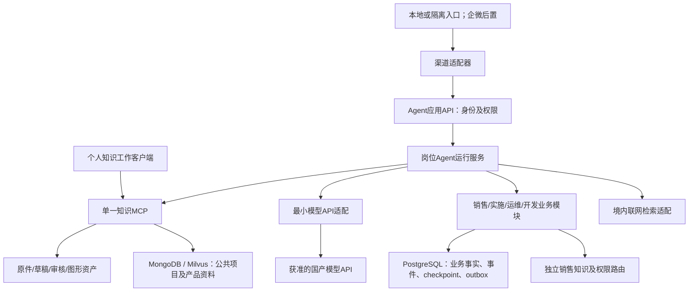
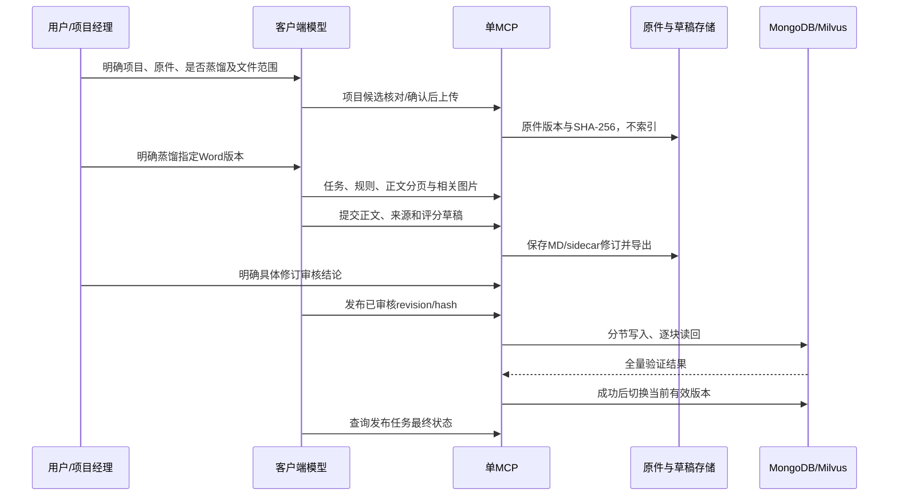
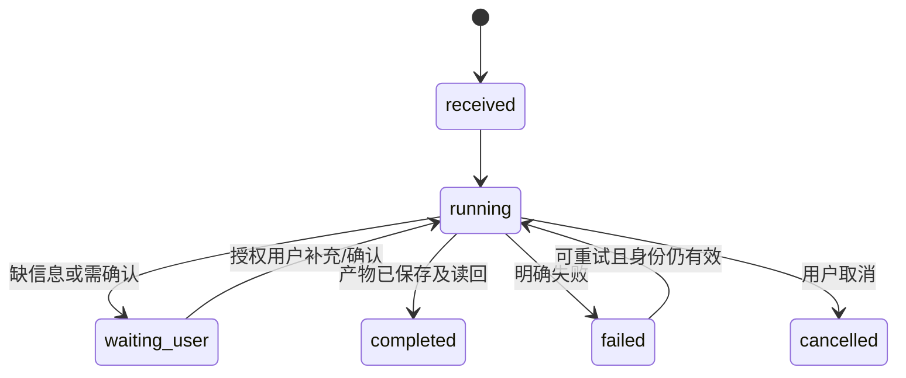

# 公司知识与业务智能体：总体架构与开发文档

版本：1.1｜更新日期：2026-10-26｜对应产品基线：[01-需求规格](01-需求规格.md) 2.1。

本文覆盖现有知识系统及规划中的业务 Agent。公司模型代理及其授权、用量和公司对话管理已移出本项目。标注“现有”的内容由当前代码和历史验收支持；标注“规划”的模块、接口、数据库和部署均尚未实现。当前知识接口以 [05](05-上传蒸馏与MD产出交接文档.md) 为准，历史实测以 [07](07-单MCP本地RAG开发与黑盒验收.md) 为准。任务唯一入口为[产品迭代看板](产品迭代看板.md)。

## 1. 架构决策与技术栈

采用模块化业务应用，知识服务与 Agent 服务按职责运行，模型仅通过最小 API 适配调用。先使用少量可独立启停的进程，业务模块之间通过清晰接口和持久化记录协作；不预先拆成大量微服务。采用“优先复用开源项目”的原则。Agent 平台经固定版本本地最小兼容验证先选定 Spring AI Alibaba，2026-10-26 应用户决定修订为 Python LangGraph（现有代码全部为 Python，切换语言栈成本高，原 Java 定案作废）；正在建设最小公共底座的知识只读适配；正式 Agent 业务服务尚未编写。Dify 不纳入本项目架构；不因可视化编排单独增加平台。详细评估见 [06](06-开源方案候选与评估维度.md)。

AgentScope 2.0.10、LangGraph 1.2.17 均完成隔离对照验证；用户以现有 Python 代码复用优先，在两个通过验证的 Python 候选中选定已在现有依赖与运行代码中使用的 LangGraph。销售状态、客户信息、商机、权限和正式业务事实都由公司业务数据库管理，框架状态不能取代业务事实库。

| 层次 | 选型 | 当前状态与理由 |
| --- | --- | --- |
| 语言与 API | Agent：Python 3.12；知识：既有 Python 3.12 | Python 隔离验证已通过；隔离 HTTP 入口已编写，正式 Agent API 及生产身份尚未完成，知识侧保留现有运行方式 |
| Agent 框架/运行 | Python LangGraph（探针验证 1.2.17；现有锁文件 langgraph 1.0.10，K17 对齐固定） | K24 本地定案（2026-10-26 修订）；Graph 显式确认流程+节点内工具循环；`ai_generate_solution` 已在 langchain/langgraph 1.x 运行。尚未实现正式业务服务 |
| 原件/知识工作流 | 现有 `src/ckp`、单 MCP | 已有 SQLite 与本地内容寻址存储；保留兼容，生产迁移归 K16 |
| RAG 文档与向量 | 现有 MongoDB + Milvus | 当前开发适配；不把开发数据库版本、无认证 HTTP 入口当作生产部署方案 |
| 业务与 Agent 状态 | PostgreSQL，独立业务 schema 与 checkpoint schema | 规划；存放身份映射、客户、商机、事件、确认和流程状态，不复制取代现有知识库 |
| 模型访问 | 业务 Agent 最小模型 API 适配 | 进行中；模拟 HTTP 已验证工具/结果/错误及本地任务队列调用；真实国产模型与完整业务集成待验；公司网关、员工模型授权、配额及用量管理为独立项目 |
| 模型与 embedding | 境内国产模型 API；首期 `deepseek-flash`，其他能力按目录验证 | 模型别名、能力、供应商版本与实际调用路由登记；现有 Qwen/local embedding 模式继续按索引契约隔离 |
| 聊天接入 | 企业微信统一后置；API 模式智能机器人后续评估 | 暂停；所有 Agent 最后统一接入，届时验证长连接和销售单聊，基础群 @、文件、确认及产物返回按租户实测；飞书不在首期范围 |
| 文件与制品 | 现有本地适配；生产对接公司境内文件服务/对象存储 | K16 暂停；本次不迁移原件和资产 |
| 异步任务 | 首期持久任务表、worker、outbox | 进行中；隔离 SQLite 已实现队列、租约恢复、原子结果和 outbox，正式 PostgreSQL 与真实接收端去重待完成；提醒调度后置 |
| 运行记录 | 任务、工具/证据、确认、产物和错误关联 | 规划；首期保留必要追溯；性能/成本测量与统一优化后置，不建设公司级用量和对话管理平台 |

新 Agent 服务使用独立 Python 依赖和锁文件，MCP 客户端仅开放所需知识工具；研究、需求确认、方案与修订以 Graph 明确编排。领域事实、证据正文、引用 ID 和确认修订计划分别持久化，引用计划由服务校验及渲染。选型中的 SQLite saver 仅用于本地探针，正式 PostgreSQL checkpoint、权限重查和 outbox 在 K17 实现及验收。

实施时对新服务生成独立锁文件，不直接升级现有 `requirements-cloud.txt` 及已验证模型/向量依赖。云端清单目前固定 `langgraph==1.0.10` 等版本，只能说明依赖存在，不能说明新的 Agent 已开发。CLI 包版本与 MCP 服务版本分别读取；对外 MCP 能力基线以 `distill_stages.server_info` 和当前工具 schema 为准。

## 2. 服务结构与两种运行方式

**个人知识客户端模式：**员工继续在获准客户端中使用模型与单一知识 MCP 完成知识任务；本项目负责知识工具与资源授权，不建设客户端模型代理和员工模型账号系统。当前蒸馏主用方式仍由客户端模型执行，不能为了新业务 Agent 静默改为服务端生成。

**托管业务 Agent 模式：**本地或隔离入口先接入 Agent 应用，企微消息在所有 Agent 最后统一接入，由选定平台在境内运行，通过最小模型适配调用获准国产 API，并调用现有知识 MCP；业务写入通过领域服务执行。系统保存本业务必要的任务、工具/证据、确认与产物记录，不承担全公司模型访问或个人客户端对话管理。

一个 MCP 服务约束针对知识工具面：原件、蒸馏、审核、发布、检索、读取、资产和撤回不拆成多个客户端 MCP。Agent 应用是业务服务，最小模型适配只是内部调用模块，不另建 RAG MCP 或公司模型网关。未来岗位写入工具需要暴露给个人客户端时，先定义权限和幂等，再在既有工具面按职责扩展；本文的规划 API 不等于现有 MCP 工具。

## 3. 现有代码与工具面

| 现有位置 | 当前职责 | 状态 |
| --- | --- | --- |
| `src/ckp/mcp_server.py` | 主 MCP、项目/原件/蒸馏/草稿、metadata catalog、版本声明 | MCP 1.5.6，静态注册 22 工具 |
| `src/ckp/knowledge_tools.py`、`knowledge.py` | 本地审核、发布任务、检索、同版读取、图形、撤回 | 9 工具；`local_development` |
| `src/ckp/product_material_tools.py`、`product_materials.py` | 产品 Word 资料独立库和原图回取 | 7 工具；与项目生命周期分开 |
| `src/ckp/store.py`、`db.py` | 本地原件、版本、上传记录、任务和草稿数据库 | SQLite/内容寻址文件存储；不提供生产多用户认证 |
| `src/ckp/md_render.py`、`quality.py` | 正文/sidecar、哈希、章节路由、评分技术检查 | 保留既有契约 |
| `src/ckp/office_parser.py` | Word 分页、表格、图片关系与渲染 | 语义理解属于客户端模型；不做 OCR |
| `src/chunks_and_in_vector/pipeline.py` | 版本固定、body 分节切片、向量/文档存储、活动指针 | 开发沙箱；审批由上层 Knowledge 负责 |
| `templates/`、`skills/knowledge-distillation/` | 模板、规则、阶段材料清单、客户端引导 | 不被售前专用材料采集替换 |
| `src/agent_foundation/` | 隔离身份、任务、确认图、知识及模型适配 | K17 进行中；本地验证范围见 K17 开发记录，不代表生产权限或正式服务 |
| `src/ai_generate_solution/` 与历史独立 MCP 入口 | 旧内部兼容模块 | 不作为新 Agent 基座或外部部署完成证据 |

当前静态共 38 工具；历史 30/31 工具验收按原版本保留，不改写为 38 工具运行验收。新框架、数据库或 API 规划不修改现有工具行为。

## 4. 现有 RAG 数据与发布链

身份链分别为 `project_id → file_id/version_id/sha256`、`knowledge_id/revision/content_hash`、`section_id → document_ref/source_refs/protected_asset_refs`。正文是业务事实载体；sidecar 保存过程与来源，不作为掩盖正文缺失的替代。发布前按精确版本验证审批和资产；重复任务幂等，失败后沿用原活动版本，撤回停止默认可见。

产品资料是另一条已有链：明确指定 Word → 校验产品和领域 → 保留原件 → 按标题/正文/表格分节 → 独立逻辑集合 → 精确修订读回。当前不经过项目蒸馏审核链。图号或位置键指向同版本原件图片，返回 MIME、来源上下文和哈希核验信息。

首期画像、需求与方案保存于售前任务存储并按精确修订读取，不必先建立跨客户销售 RAG。后续销售知识库复用身份、来源、哈希、分节和版本原则，采用销售域分类及确认/发布流程；现有项目发布入口强制六阶段，不能直接传销售画像并伪造 stage。销售域发布器和检索路由属于后续待开发范围。

## 5. RAG 适配层契约

`KnowledgeGateway` 已有只读实现：调用方提供 MCP session 和授权回调，按项目/产品路由检索、逐条授权、同版补读并生成初步证据结构；合成 MCP 成功链路已验证，真实知识库和生产权限仍待验证。公共项目、产品资料、销售知识三个逻辑域独立授权，再按任务需要合并证据。

| 操作 | 现有工具 / 规划能力 | 约束 |
| --- | --- | --- |
| 项目知识检索 | `search_knowledge` | 不臆造 stage/products/domain 过滤；默认已发布活动版本 |
| 项目正文读取 | `read_knowledge` | 精确 knowledge/revision/hash，先相关 section_ids |
| 图形结构读取 | `get_asset` | 同版且由命中 body 分节实际引用 |
| 产品规范检索/补读 | `search_product_materials` / `read_product_material` | 独立 corpus，精确 material/revision/source_sha256 |
| 产品原图 | `read_product_material_image` | 只用返回的唯一 figure_id；不按语义猜图 |
| 销售域检索/发布 | 待开发 | server-side ACL 与 sales 分类；不复用六阶段发布器冒充已支持 |

证据结构至少含 `corpus`、知识/材料身份、修订、内容/源哈希、章节路径、原始片段、来源定位、事实状态、适用产品/版本、质量缺口、受保护资产引用。搜索分数只表示匹配程度。

决策流程：命中足够 → 回答；缺前提/限制 → 同版定向补读；整体/跨章/冲突且定向不足 → 同版全文；需要节点关系 → 同版资产。首期直接复用已有规则与精确读取；缓存归后期 K14，实施时按用户权限范围、语料域、版本/hash 和 section_ids 分键，并在撤回或权限变化时失效。工具异常明确为失败/缺口，不让模型用过期或其他版本内容补空。

售前方案生成按需求建立检索计划，在写作时持续查询/补读所需产品流程、规则、前提、限制和项目实践。规划的需求设计单元至少保存客户依据、产品/服务支持片段与精确来源、客户化业务步骤、系统关系、配置/定制分类、适用条件与缺口、价值机制和销售沟通建议。原始证据、产品事实与模型提出的设计建议分别标识；不能只把模块名或搜索摘要传给写作节点后直接生成完整方案。

工作流为“需求及提纲 → 分需求检索/补读 → 证据与设计映射 → 详细正文/图示 → 引用支持与正文深度检查 → 销售审阅修订”。保存设计单元到正文位置和证据版本的映射，需求/产品版本变化时重新核对受影响部分。销售推进建议仅形成方案内容；不会自动创建后置跟进台账、发送通知或更新销售阶段。以上设计单元和检查节点均为待开发契约，不声称现有 MCP 已提供对应接口。

## 6. Agent 运行与领域写入

规划的标准请求上下文：`org_id`、可信 `employee_id`、`channel`、`channel_user_id`、`conversation_id`、`thread_id`、`message_id`、被选客户/商机/项目、权限快照版本和 `trace_id`。服务端从令牌或已验证渠道事件建立身份，不信任客户端自报的负责人或角色。

Agent 运行状态仅保存本次任务需要的数据：任务类型、输入引用、已选实体、证据版本、结构化候选、确认点、缺口、运行状态。正式业务数据通过领域服务事务提交；业务写入失败不能把 checkpoint 中的候选当作已保存事实。

节点分为模型节点、检索节点、业务读取节点、人工确认节点、事务写入节点和交付节点。简单问答只走必要节点，单模块成功不自动启动后续销售动作。用户补充/纠正已有任务时续接同一任务；另一个商机使用独立上下文。

等待确认需绑定任务、对象修订、确认内容哈希与允许确认人；旧卡片确认不能覆盖新修订。恢复时重新检查权限与对象版本。外部发送/写入节点可能因恢复重入，必须使用幂等键、事务记录和 outbox，不能把 checkpoint 当作“外部动作恰好一次”的保证。

## 7. 业务与记忆数据模型（规划）

首期只实现渠道无关的员工身份与权限、售前任务、客户主体、来源/事实、画像修订、需求基线、公司能力引用、确认记录和方案修订。完整商机台账、沟通活动、销售阶段、行动/提醒和周报快照后续扩展。保存任务输入和修改版本是首期运行需要，不要求销售先完成沟通登记。

| 实体 | 关键字段和关系 | 事实边界 |
| --- | --- | --- |
| 员工与渠道账号 | employee、channel_identity、role_binding、resource_grant | 平台 ID 映射到企业员工，不按显示名识别人 |
| 售前任务 | presales_task_id、employee_id、customer_id、业务场景、source_refs、画像/需求/方案版本、grants | 首期客户与资料归属容器；商机编号可选，不承担销售阶段或跟进管理 |
| 客户 | customer_id、正式名称、别名、主体确认、industry、owner/grants | 同名候选由销售确认，不自动合并企业 |
| 商机 | opportunity_id、customer_id、owner、阶段、参与者、阶段变更历史 | 客户与商机分开；阶段由销售确认 |
| 来源/事实 | source_id、URL/文件版本、发布/获取时间、位置、事实状态、可见范围 | 事实/线索/假设/人工确认分开 |
| 画像修订 | profile_id/revision、fact_refs、valid_time、approval、hash | 不可变快照，后续追加更正与替代关系 |
| 需求及痛点 | baseline/revision、需求编号、客户依据、优先级、确认人 | 未确认候选不能作为已确认营销重点 |
| 沟通互动 | interaction_id、商机、实际时间、人员、渠道、反馈、结果、source_messages | 去重一次真实沟通，消息数与模型请求数不作为沟通次数 |
| 行动与提醒 | action_id、owner、due_at、timezone、状态、reminder_key | 无日期保留待安排；延期/撤销使旧提醒失效 |
| 确认记录 | task_id、目标修订/hash、actor、decision、时间 | 追加留痕，不静默覆盖历史 |
| 售前方案修订 | proposal_id/revision、task_id、画像/需求/能力/证据版本、内容/文件引用、审阅状态 | 首期保存实际产物及修改；生成成功不表示已发客户或客户已接受 |
| 管理报告快照（后续） | report_id/revision、时间范围、使用事实版本、生成/确认/发送状态 | 周报以结构化数据快照汇总，AI 仅组织表达 |
| 会话/checkpoint | thread_id、employee/grants、task、checkpoint namespace | thread_id 是运行身份，不能单独作为权限凭证 |

长期记忆包括稳定偏好、确认事实与知识，不自动把全部对话向量化注入。正文检索先做资源过滤，群回答的可见范围按接收群的授权范围确定；发问者个人权限不能自动扩大群成员可见内容。个人私聊偏好不默认同步到群或管理层。

## 8. 模块与接口规划

建议新建应用目录时按 `agent_platform`（身份/会话/证据/运行）、`sales`、`implementation`、`operations`、`development`、`model_adapter` 分模块；现有 `src/ckp` 和索引代码保持知识职责。具体代码目录在首个实现任务中落地，本文不声称目录已存在。

规划业务 API 统一包含 `request_id`、幂等键、对象版本、可信 actor、trace；列表读取按授权过滤，写入返回实际保存版本和状态。首期代表性入口为“创建售前任务/查询/继续讨论”“客户主体选择”“客户研究/画像修订”“需求基线确认”“方案生成/查询/修订”；沟通记录、正式商机阶段、行动与管理报表接口后续扩展。以上是完整领域 API 的规划；当前 `agent_foundation.http_api` 已提供隔离本地任务、修订、确认和模型任务的部分 HTTP 路由，非 MCP 工具，也未实现完整业务接口。

外部消息快速确认接收后交给 worker，长研究/报告任务返回任务状态并异步交付。平台消息重试按平台 event/message ID 去重；不对已发送的卡片、提醒和周报重复发送。每次交付保存接收范围、内容版本、平台回执和失败信息。

## 9. 模型接入与部署边界（规划）

本项目首期只配置获准的境内国产模型 API、模型版本和凭据引用，由内部 `model_adapter` 处理工具调用、结构化结果、传输错误及任务关联。模型调用能力与企业知识权限分别验证，不建设员工模型账号、统一网关、配额用量和公司对话管理；不以独立公司模型代理项目为本阶段开发前置。

Agent 应用、知识数据、任务状态及业务文件按境内资源设计，可先采用受控单机/隔离试点。公网接入、数据库、文件服务和多用户权限按实际部署范围验证；不因企微或模型可调用就宣称公司知识生产链已接通。

生产知识迁移依赖 K16 恢复后完成真实文件服务、远程身份、授权、发布/撤回和备份恢复。若迁移 SQLite 元数据，保留文件/知识 ID、revision、hash、审核和活动指针；embedding 模型、版本或维度变化另建索引与回归，不随推理模型切换。

## 10. 交付顺序与状态映射

第一阶段主线仅为 **K24 平台选型 → K17 公共底座 → K15 首个售前闭环**；顺序和唯一任务状态见看板。

| 范围 | 看板 | 实现状态 | 前置与交付 |
| --- | --- | --- | --- |
| 已有知识与产品资料 | K01–K11 | 本地完成 | 以 05/07 指定契约和原始验收范围为限 |
| 第一阶段① Agent 平台选型 | K24 | 本地最小验证及定案完成 | Python LangGraph（2026-10-26 修订，原 Java 定案作废）；实际证据及未验范围见 06 和选型记录 |
| 第一阶段② 公共底座 | K17 | 进行中 | 前置 K24；渠道无关身份、任务/状态/确认、知识适配、最小模型 API 与产物保存 |
| 第一阶段③ 首个售前闭环 | K15 | 待开发 | 前置 K17；知识 → 画像 → 需求 → 详细方案/推进建议 → 修改及人工业务验收 |
| 后续销售/其他岗位功能 | K15 后置子项、K18–K20 | 待开发/需求讨论 | 按业务需求安排，不计入第一阶段 |
| 文件类型扩展 | K12/K13 | 讨论/暂停 | 不阻塞已有 Word 知识试点，PDF 保持暂停 |
| 公司知识生产接续 | K16 | 暂停 | 多人生产依赖实际适配完成；本次不恢复 |
| 最后统一优化类别 | K14/K25 | 后置、尚未开展 | 单独建立优化基线及前后对比，不与第一阶段开发并行 |
| 文档同步制度 | K23 | 文档完成 | 相关产品/开发/接口/看板与协作规则同步 |

本次已完成隔离安装、真实模型工具调用、本地 MCP 和正常进程退出后恢复的最小验证及平台定案；未完成企微、生产持久化或正式 Agent 业务实现。首期保留必要正确性验收和阻塞缺陷修复，RAG 调优与其他应用提质降本统一后置。

## 11. 开发、验收与运维要求

每个模块定义输入、状态、输出、确认人、写入和通知范围、依赖及可关闭方式。首期以同一客户从知识、画像、需求到售前方案并支持修改的完整场景验收，独立问答通过不能代替该场景。先对合成资料做逻辑检查，再用获准的真实材料验证；企微客户端在统一接入时另验；单元测试、模拟、真实模型、真实外部系统和人工业务验收分别报告。

第一阶段验证知识引用、版本和来源支持，画像/需求纠错、详细方案与推进建议可用性，以及工具调用、任务恢复和保存结果；企微在所有 Agent 最后统一接入并验收。后期 K14/K25 再集中建立检索/回答/工作流的噪音、返回量、时延及可得成本基线并优化；后续销售记录、阶段与周报能力随各自模块验收。历史测试数不是本轮重跑结果，完整套件通过也不能代替新模块验收。

错误区分身份/权限、输入版本冲突、缺证据、供应商限流、传输失败和业务确认未完成。只对瞬时故障有界重试，业务写入不因重试重复；断流保留未完成状态和计费不确定项，不伪装成功。模型下游输入视为资料，不接受网页/文件内对工具与权限的指令。

日志使用 trace/request/run ID 贯通，密钥不写日志。运行事件与模型请求相互关联但不混作同一计数；对象存储保留原件和报告版本，业务数据库保存引用。计划备份与恢复演练应覆盖业务事实、checkpoint、文件/资产、索引配置和密钥引用，并分别验证恢复后的权限和活动版本。

迭代完成时按[项目记忆](项目记忆.md)同步产品、开发、当前接口、验收记录和看板。技术选型改变需记录原因、影响和迁移范围；不因文档新增计划自动变更代码依赖或生产状态。

## 12. 选型依据

查阅日期：2026-10-26。以下仅支持框架和客户端能力判断，实际公司部署仍待实测。

- [Agent 平台候选与评估维度](06-开源方案候选与评估维度.md)：三候选实测比较、平台定案（2026-10-26 修订为 Python LangGraph）及底座适配范围。
- [DeepSeek API](https://api-docs.deepseek.com/quick_start/agent_integrations/)：国产模型 API 与客户端集成入口；使用供应商公开 API 契约，不依赖网页账号自动化。
- [腾讯官方：企微智能机器人接入](https://cloud.tencent.com.cn/document/product/1759/121473)：说明单聊、群 @ 及长连接/URL 回调入口；据此优先评估 API 模式智能机器人，实际租户、附件、确认和交付能力仍待验证。参考渠道能力不表示采用腾讯云智能体开发平台。
