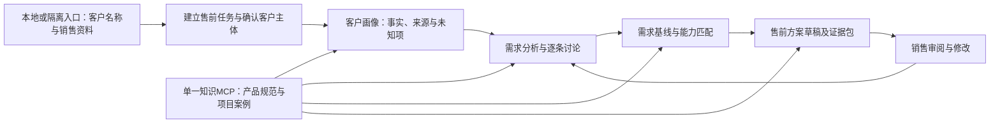
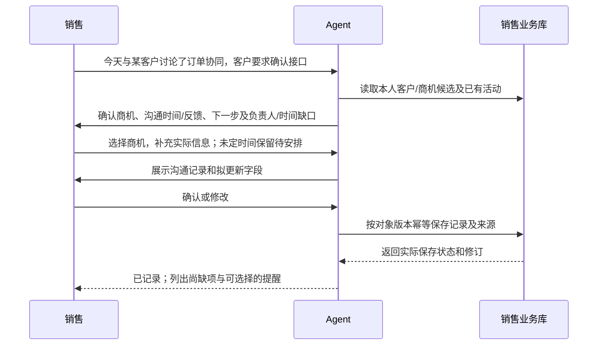

# 售前、实施、运维、开发 Agent：业务与交互开发方案

版本：1.1｜更新日期：2026-10-26｜产品基线：[01](01-需求规格.md)｜架构：[02](02-总体架构与开发文档.md)。

本文件是待开发方案，不表示任何岗位 Agent 已运行。Agent 平台已选定 Python LangGraph（本地最小兼容验证，2026-10-26 修订，原 Java 定案作废），后续按 Python 建设最小公共底座和售前闭环，知识侧复用现有 Python 单 MCP；当前只有知识 MCP/RAG 及相关本地工作流已交付。售前优先，实施、运维、开发逐个规划和验收；任务状态以[看板](产品迭代看板.md) K15、K17–K20 为准。

## 1. 公共能力与使用入口

### 1.1 岗位定位

售前 Agent 首期解决销售准备客户沟通和售前方案的场景：检索公司知识、形成客户画像、分析并确认需求，产出可供销售修改和使用的售前方案草稿。销售记录、商机阶段、跟进、提醒和周报作为后续销售管理扩展，不作为首期前置。策略提议保留建议状态，不能记为客户认可或交付承诺。

实施 Agent 支持项目交付步骤、配置与验收准备；运维 Agent 支持环境定位、诊断与处置建议；开发 Agent 支持需求、接口和代码任务。每类岗位具有独立业务对象和确认点，共用检索、身份、最小模型 API 适配、运行状态与来源追溯。

### 1.2 渠道和身份

公司当前使用企业微信；2026-10-29 决定租户接入作为所有 Agent 的最后统一任务，当前不做。首期使用本地或隔离入口，后续按企业微信设计。建议以 API 模式智能机器人承接销售单聊，群 @ 作为基础协作入口；两种入口共用完整售前任务。飞书不在首期范围。实际接入时验证租户开放能力、身份字段、消息/附件、结果返回和客户端体验，不能直接套用其他平台的事件或卡片契约。

系统从已验证的平台事件和连接建立可信身份，映射企业员工和权限。首期创建售前任务，绑定销售、客户正式主体、本次业务场景和授权范围，保留输入资料、画像/需求修订和方案结果；已有商机标识可选，不强制先建商机台账或登记沟通。客户相同而场景不同可新建任务，跨任务引用注明来源；群内多客户先选择任务，真实发言人和消息引用须保留。

接入建议优先验证长连接；URL 回调为另一种可验证方案。2026-10-26 查阅的[腾讯官方接入说明](https://cloud.tencent.com.cn/document/product/1759/121473)列出单聊、群 @ 和长连接/URL 回调两种方式。此处仅借鉴企微渠道能力，不表示采用腾讯云智能体开发平台，也没有验证公司租户或完成接入。附件格式、卡片确认、长任务回复及方案下载方式以实际 API 和客户端验证确定。

群内默认仅处理 @ 或业务明确触发的消息，不承诺订阅所有聊天。复杂研究返回任务状态，完成后在原话题交付摘要及有权限的详情入口。私聊记忆用于个人工作，群输出以群资源授权为准；没有足够群可见权限时返回允许公开的摘要或转授权私聊。

### 1.3 记忆与业务状态

| 类型 | 记录内容 | 更新方式 |
| --- | --- | --- |
| 当前会话 | 任务、选定对象、上下文摘要、待追问、待确认 | 持久 checkpoint；恢复时检查权限和对象版本 |
| 员工偏好 | 输出方式、常用职责和本人设定 | 本人可查可改；不是客户事实或权限依据 |
| 客户/商机事实 | 主体、画像、需求、痛点、阶段、反馈 | 引用原始来源，按确认形成修订 |
| 行动记忆 | 下一步、负责人、时间、结果与延期 | 明确创建和更新，提醒去重 |
| 岗位知识 | 已确认画像、销售复盘、领域经验 | 独立销售域或相应知识发布流程，不把全部聊天自动入库 |

模型提出结构化候选，领域服务负责校验、权限、版本和落库。已确认事实修改时追加修订或更正，不静默覆盖；冲突展示来源和冲突字段。任务运行记录的访问按业务授权控制。

## 2. 首期售前场景、模块与依赖

首期验收完整场景：销售提供客户名称、业务背景和已有材料，Agent 联网研究客户并检索公司产品/项目知识，与销售讨论需求，形成售前方案；销售可以补充资料、修改画像/需求并要求重生成。知识问答可以单独使用，但只交付问答不代表首期完成。

| 首期环节 | 销售输入 | 交付内容 | 销售讨论点 |
| --- | --- | --- | --- |
| 查公司知识 | 产品、业务问题或客户场景 | 带来源的回答、适用案例与证据缺口 | 是否适用本次客户，缺什么资料 |
| 客户画像 | 正式主体、官网/资料、销售补充 | 客户业务、组织/角色、系统/流程、动态、已知问题和未知项 | 主体与事实纠正；公开资料没有覆盖的情况 |
| 需求分析 | 画像、调研/面谈内容、业务目标 | 编号需求、痛点影响、目标、优先级、约束和验证问题 | 接受、修改、否决；行业假设不能替代客户诉求 |
| 售前方案 | 需求基线、产品/服务目录和项目证据 | 客户化详细业务设计、能力映射、图示（适用时）、边界、价值、销售推进建议和内部证据包 | 具体业务方案、建设范围、待核实能力及下一轮客户沟通目标 |

首期最小存储为任务、客户主体、输入来源、画像修订、需求基线、能力目录引用和方案修订。客户画像可在本任务内按精确版本使用；跨任务的销售知识检索、销售域发布/撤回是后续增强，不阻塞单客户首期场景。

| 模块 | 看板 | 输入与输出 | 上线前置 |
| --- | --- | --- | --- |
| S1 知识助手（首期） | K15.1 | 问题 → 可引用的答案与证据缺口 | 渠道无关的 K17 最小基座、现有 K08–K11；企微统一后置 |
| S2 客户商机与沟通记录（后续） | K15.2 | 交互/材料 → 结构化沟通候选 → 确认记录 | 首期场景形成后，再扩展正式业务实体和记录服务 |
| S3 客户研究与画像（首期） | K15.3 | 主体、销售资料、公开来源 → 带来源的画像修订 | 最小客户任务上下文、联网及来源存储；不依赖 S2 |
| S4 需求和痛点确认（首期） | K15.4 | 调研/面谈/纪要及画像 → 需求基线、痛点、营销重点 | 最小客户任务上下文、S1、公司能力目录；不依赖 S2 |
| S5 售前方案（首期） | K15.5 | 画像/需求基线、产品与案例证据 → 方案草稿及内部证据包 | S1/S3/S4；资料不足时明确缺口及草稿范围 |
| S6 行动与提醒（后续） | K15.6 | 确认记录及下一步 → 行动/到期/缺项提醒 | 首期后、S2、持久任务/outbox |
| S7 个人与团队周报（后续） | K15.7 | 期间确认记录 → 周报快照、缺项清单、授权交付 | 首期后、S2；有 S6 时汇总行动状态 |
| S8 多人群协作（后续） | K15.8 | 共享讨论 → 发言归属、协同确认和任务转交 | 基础 @ 随企微统一接入后置；此项做更深群业务协作 |
| S9 企业微信统一接入后客户端验收（后置） | K15.9 | 企微单聊/基础群 @ → 任务、讨论和产物入口 | K17.5 在所有 Agent 最后统一接入；本项验收渠道，非企微业务场景归 K15.10 |
| 首期场景验收 | K15.10 | 同一客户资料 → 画像 → 需求 → 方案 → 修改后的实际产物 | S1/S3/S4/S5；需人工业务评审，S9 单独后置 |

第一阶段顺序为 K24 平台选型 → 渠道无关的 K17 最小公共底座 → K15 售前闭环（S1 → S3/S4 → S5 → 首期场景验收）。模块检查用于定位问题，首期以完整客户场景是否可用为准。S2、S6、S7、S8 以及跨任务销售知识管理后续逐步完善。生产多人使用须完成 K16 对应身份与知识服务适配；该暂停任务本次不恢复，本地/隔离试点与生产上线分别验收。

首期验收选取获准的真实客户场景和销售提供的材料，保存首次产物与人工修改：知识引用支持结论，画像不混淆主体或补造系统，需求能对应客户依据或明确假设，方案逐项展开业务处理、产品支撑、规则/异常、系统衔接、实施边界和价值机制，并能据此开展客户沟通。销售评审业务理解、正文规划深度、推进建议可执行性和修改工作量；目录齐全、功能词汇齐全或模型自评不能代替场景验收。没有实际客户沟通记录仍可完成该场景。

当前需继续深化的事项为：典型首个客户场景、画像和需求必要字段、追问/确认体验、八部分方案内的业务场景细化与交付格式、联网与材料准入、能力目录责任人，以及首轮人工验收方式；这些是范围设计问题，不表示已经实现或验收。

第一阶段通过 K17.7 最小模型适配调用获准国产 API，模型调用及其权限按实际范围验证。公司模型代理已作为独立项目移出，不是本项目开发或验收前置；共享知识的生产身份/文件链仍按 K16 实际状态管理。K14 RAG 调优和 K25 其他 Agent 应用优化统一归最后优化类别，不与当前主线并行。

## 3. S1 知识助手

主线为接收消息 → 识别意图和权限 → 按需查询项目档案/产品手册 → 判断证据充分 → 同版定向补读 → 回答并记录证据。RAG 规则沿用 K08；不因更换 Agent 框架而改为每问必读全文。

产品问题优先产品规范，案例/实施经验优先项目档案，综合问题才联合两路。回答区分标准功能、特定项目实现、规划能力与未确认内容。对截图需求按产品手册的精确图号/位置键获取同版图片，对流程关系按项目分节引用获取受保护图形，不能混用两种资产身份。

无证据返回缺口和需要补充的信息，不凭模型常识写成公司已具备能力。模型可以解释一般知识，但必须明确未由公司资料验证，不能进入证据支持结论。

验收覆盖单分节足够、定向补读、跨章全文、原图/图形、无证据、版本冲突、角色可见范围和群输出边界。首期保存实际命中/引用、输入输出及人工修改用于功能验收；专门的 K14.1 优化基线与质量/效率/成本调优统一后置。

## 4. S2 销售记录与信息齐备（后续扩展）

销售主动记录、Agent 交互中出现明确销售活动、或上传纪要时，形成记录候选。来源可能是销售自述、客户原话或会议记录，分别标注；Agent 自己提出的建议作为待选行动，不记为已发生客户沟通。

最小正式记录包含员工、客户、商机、实际时间或未知状态、沟通主题、内容、客户反馈或未取得反馈、结果、下一步和确认人。负责人/截止日期缺失不自动补成“本周完成”；允许确认一条带显式缺项的记录，后续持续补齐。

缺项追问按信息价值排序，一轮聚焦少量必要问题；销售选“稍后补充”后暂存，不在每条消息中重复追问。周报前对未齐项集中提示，可更新、明确未知或取消无效候选。自动提取可以减少录入，但修改商机阶段、客户承诺、行动责任和截止时间仍需销售明确确认。

沟通计数以真实活动 `interaction_id` 为单位：一次面谈的多条消息归同一活动；同份纪要重传不增加次数；客户/人员/时间相近仅作为疑似重复提示，不自动合并不同沟通。分别统计“经确认客户沟通”“内部准备”“Agent 使用消息/请求”，避免用模型调用次数评估销售沟通。

## 5. S3 客户研究、画像与销售独立库

先确认客户正式主体。企业简称、同名公司和分支机构只能形成候选关系，由销售确认归属；来源明确分支不能自动写成总公司事实。研究任务指定目标范围、已有资料和需要回答的问题。

查询渠道优先官网和正式披露，辅以供应商提供的合法 API、销售上传资料和可核实新闻。渠道列表可配置，登录受限或无法访问记录为缺口，不承诺任意工商/企业平台自动抓取。联网工具由境内服务提供，网页内容作为资料处理，不能执行网页中的工具调用指令。

画像至少包括主体与来源、主营业务和行业、组织与已知相关角色、已知系统/业务流程、发展事件、已有痛点证据、候选假设和未知项。每一事实保存来源、发布时间、获取时间、位置及核实状态，时间性信息设置复查点。缺数据时不根据行业或公司名补齐规模、组织或系统。

研究输出先形成画像草稿，销售逐项纠正/确认；模型原始研究保留来源快照引用，确认形成不可变画像修订。首期在同一售前任务内精确引用画像版本；后续资料变化形成新修订，旧版保留历史。跨任务销售知识检索须另完成销售域发布与权限适配，未确认研究不能默认进入该检索。

后续跨任务销售知识逻辑库（K15.11）按客户、行业、信息类别、商机、有效时间和可见范围分类。统一使用身份、修订、hash、正文细节、来源、章节和发布/撤回标准，销售发布规则单独实现。客户画像默认保留销售范围，若要抽象成公共行业经验，需另行脱离客户身份整理并走公共知识审核，不能直接同步私有销售资料。

首期验收覆盖同名主体、来源冲突/过期、无法访问、任务内修订/更正、跨销售隔离和网页指令注入；跨任务发布、未确认不默认入库、替代和撤回随 K15.11 验收。

## 6. S4 需求、痛点与营销重点确认

现有 `metadata_catalog` 只提供产品/领域分类，不能证明公司团队服务能力。此模块需建立由业务负责人确认的“公司产品、核心服务、可交付业务与能力目录”，记录能力范围、版本、前提、限制、支持证据、负责人和有效状态。目录可先人工维护，经确认后再用于匹配；不能把历史项目做法自动提升为公司当前承诺。

输入为销售指定的调研记录、面谈、会议纪要、补充说明，及可用画像/行业参考。解析格式按模块单独准入，先支持文本和明确支持的文件类型；不因纪要分析需求而绕过当前知识蒸馏的 Word 范围限制。未支持格式提示转换或提供正文，不假称已读。

Agent 工作流为：读取来源 → 抽取客户事实/原话 → 梳理业务对象、流程、问题与目标 → 按公司能力和行业线索补充验证问题 → 需求候选 → 销售逐条讨论 → 确认基线。

| 需求字段 | 用途 |
| --- | --- |
| 需求编号及描述 | 连续“需求1…”；写业务问题/目标，不用功能名称代替需求 |
| 客户事实与来源位置 | 证明客户确有相应现状/诉求；只由行业材料支持时标假设 |
| 痛点、影响、期望结果 | 以来源说明业务环节和影响，影响金额/比例缺证据不填 |
| 角色、优先级与约束 | 决策人未知明确待确认；不按员工头衔推定采购决定权 |
| 公司能力候选及边界 | 标准产品、服务、定制、外部依赖或待确认 |
| 状态与确认记录 | 候选、待确认、已确认、已否决、被替代；确认绑定修订 |

销售可以接受、修改、否决或补充证据。没有可支持需求时返回调研缺口；需求分析失败不把原始文本分段冒充分析结果。最终营销重点只使用已确认痛点与明确假设，保留每项建议的验证动作；新材料影响已确认项时提示修订，不能覆盖已用于报告的旧基线。

验收覆盖事实与假设混淆、需求遗漏/新增、业务描述质量、服务能力边界、逐条确认、旧卡片确认冲突与修订追溯。

## 7. S5 售前方案

方案绑定客户画像、需求基线、公司能力目录和检索证据的精确版本。前置资料未齐时生成明确范围的草稿，不能宣称为完整方案。

### 7.1 产物定位与参考方式

首期交付可编辑、面向本客户的详实售前方案，销售能据此解释建设内容、讨论适配条件和推进下一轮沟通。正文保留业务步骤、规则、前提、异常、系统关系和设计原因，不能只输出能力名称、宣传词汇或章节提纲。内部证据包补充来源与追溯，不能替代正文业务设计。

只读参考旧项目的[售前草稿模板](../../company-brain/templates/售前草稿模板.md)，采用其中“每章先核心思路再展开、产品匹配说明原因、管理价值解释机制、团队与案例有依据、后续沟通有目标”的要求，沿用当前更完整的八部分结构。旧模板的“每条约 50–100 字”仅作短说明的历史写法参考，不作为详细设计篇幅上限；复杂需求按必要段落、流程和表格充分展开。旧模板的采购协同等示例、A5 编号或固定图形不能直接变成本项目的客户事实、业务范围和产物。

### 7.2 方案正文八部分

| 章节 | 必须展开的业务内容 |
| --- | --- |
| 一、客户背景与业务现状 | 与本次销售相关的业务特点、组织/角色、现有流程及系统、关键事实与未知项；说明这些情况为什么影响建设选择 |
| 二、痛点、需求与建设目标 | 沿用“需求1…”编号，说明现状、发生环节、影响、期望改变、优先级和约束；保留客户依据，行业推断明确为待验证 |
| 三、总体建设思路 | 推荐的产品/服务组合与先后关系、业务及系统边界、选择理由和适用条件；说明已有系统如何继续承担职责 |
| 四、逐项业务场景与解决办法 | 每项需求展开参与角色、业务对象、输入、处理步骤、规则/异常、输出和闭环；把检索到的能力落实到客户业务过程 |
| 五、产品、服务、流程与接口设计 | 说明产品模块和版本、配置/实施服务、数据归属与流转、系统衔接和接口前提；区分标准能力、配置建议、定制/集成建议及待确认事项，配适用流程图和架构图 |
| 六、建设范围、分期与交付边界 | 各期业务范围、关键交付内容、输入/前置、客户配合、公司服务证据、外部依赖及可讨论的验证点；未确认报价和工期不能写成承诺 |
| 七、适用案例与业务价值 | 案例具体做法、实际结果及相似/差异条件；解释本方案如何改变管理动作、减少重复工作/等待或改善异常处理，量化需实际依据 |
| 八、后续客户沟通与推进建议 | 基于方案的关键假设、能力缺口、客户配合项和决策障碍，给出下一轮沟通目标、对象角色、具体问题、需带材料和希望确认的结果；未知角色与时间保留待确认/建议 |

每章先给核心思路，再展开本客户设计。案例集中介绍一次，其他章节按需引用；产品截图只从同版手册精确定位，图文表达与正文一致。具体 Word/PPT 等交付格式继续讨论。

### 7.3 每项需求的详细设计单元

| 设计内容 | 要回答的问题 |
| --- | --- |
| 客户问题与目标 | 谁在什么业务环节遇到什么问题，客户期望改变什么，有什么实际依据？ |
| 产品依据与推荐理由 | 哪个产品/版本/模块及手册章节支撑该设计，关键功能如何解决问题，为什么适合本客户？ |
| 业务处理方案 | 从什么输入触发，哪些角色按什么顺序在什么系统处理，关键规则、状态、异常、结果如何安排？ |
| 系统与数据关系 | 数据由哪个系统维护、如何传递、同步/接口依赖什么，客户现有系统承担什么职责？ |
| 落地与边界 | 哪些已有标准能力可使用，哪些是建议配置/业务设计，哪些需要定制或接口验证，具备什么前置条件？ |
| 价值机制 | 哪个具体管理动作或人工操作会改变，为什么会改善效率或管理；需要哪些客户基线才能量化？ |
| 销售推进点 | 下一轮应向哪个客户角色核实什么，准备什么材料，确认结果如何影响范围或方案选择？ |

这些内容可以在正文相邻段落或表格中组织，不要求机械重复相同小标题；所有关键细节须进入正文。未检索到的规则、接口或能力不能靠扩写补齐，可提出清楚标注的设计建议，并保留验证条件。

### 7.4 从 RAG 证据到详细方案

按需求建立证据计划，分别查产品手册、标准方案/项目经验和已确认的服务能力。先读取命中分节；存在业务流程、参数、前置条件、限制或关联章节缺口时同版定向补读，跨章整体关系仍不足才读全文。不能仅用命中标题、摘要或搜索分数完成详细方案。

对每项关键推荐保存“产品支持什么及来源 → 客户需要什么及来源 → 建议如何组合/配置 → 依赖、差距和待验证项”。产品手册约束当前标准能力，项目案例提供实际做法与适用条件，服务目录约束公司可交付范围。模型可组合这些证据提出客户化业务设计，但必须将产品已验证事实与方案设计建议清楚区分；案例存在不能自动证明当前产品已标配该能力。

生成流程为：需求及提纲 → 分需求检索/补读 → 证据与设计映射 → 详细正文及图示 → 检查正文深度和引用支持 → 销售审阅修改。补充需求或调整产品版本时重新核对受影响的证据、正文、图示与推进建议。方案相关的知识调用应发生在详细写作过程中，不能只在任务开始检索一次。

### 7.5 支持销售推进

方案正文提供可用于客户交流的主张和建议；内部证据包保存完整来源、核实状态和限制。销售可先审阅提纲、补充事实，再要求细化或重生成，修改绑定画像和需求的具体修订。建议方案中可以写需要进一步确认的建设内容，不能将其写成已具备的产品能力、已确定的报价/工期或已发生的收益。

每项重点建议关联具体推进目的，例如核实影响范围、确定业务优先级、确认现有系统接口条件、让相关角色认可建设方向；说明建议沟通对象的角色、问题和资料，以及希望取得的确认结果。客户决策角色、预算、时间和承诺没有依据时保留未知，不从头衔推定决定权。销售可以基于方案组织下一轮需求澄清、范围讨论或技术沟通；演示仅在用户明确需要时安排。沟通推进建议属于首期方案内容，持续跟进台账、自动提醒和周报仍为后续功能。

### 7.6 证据、质量检查与交付

证据包映射“需求 → 推荐结论 → 产品规范/项目案例/公司服务目录 → 修订/章节/来源 → 条件/缺口”。历史案例只证明适用实践，不替代产品当前规范；规划效果和实际验收结果分开。流程图和架构图从已支持信息生成，建议接口清楚标建议，不能画成已核实集成。

质量检查逐条保存结论、位置、依据和未解决项：客户事实、需求覆盖、正文业务步骤/规则/异常/衔接细节、产品版本与引用支持、服务边界、价值机制、推进建议、承诺、图文一致与产物保存。仅列模块名或“提升效率”等结论、只在证据包保留细节、没有实际读取来源支撑关键能力的产物应标需修订。获取检查规则不等于通过检查。输出状态可为“待确认草稿/需修订/内部检查通过”，业务确认不等于客户验收。

交付方案、内部证据包、检查记录和必要图示的实际版本及路径/授权链接，本地或隔离入口交付产物；企业微信接入后再返回摘要和可访问产物入口。Agent 可列出下一步建议；后续启用 S6 后，销售确认的行动再进入提醒。方案生成不自动发给外部客户或更新商机阶段。

## 8. S6 行动、提醒与 S7 周报（后续扩展）

### 8.1 行动与提醒

每个行动有商机、内容、负责人、建议/已确认时间、时区、来源、状态和提醒规则。默认使用企业配置时区，记录实际时区；用户明确“下周二”等相对日期时显示解析日期并确认，未给时间不能编造。

提醒分为“行动到期”“行动逾期”“记录缺项”“周报前补齐”。定时任务保存到业务库，使用稳定提醒键和发送 outbox；完成、延期或撤销后旧提醒不再发送。被提醒人可完成、延期、关闭；提醒应合并缺项、避免重复催促。生产自动推送仅在模块获准启用并配置接收范围后运行。

### 8.2 周报生成与管理层视图

周报按公司配置的统计周期和截止时间从结构化记录汇总，不能直接把模型请求日志归纳成销售事实。生成时固定数据快照，记录后续修订，支持销售个人确认和团队汇总。

| 周报列 | 数据来源与口径 |
| --- | --- |
| 销售人员 / 客户 / 商机 | 员工与商机关系；协作人员不重复计算活动 |
| 当前阶段及变化 | 截止时点的已确认阶段与变化时间 |
| 本周沟通次数 | 统计期内已确认的客户沟通 interaction_id 去重；未知日期另列 |
| 内容 / 客户反馈 / 结果 | 已确认记录及来源；无反馈与未记录分别标注 |
| 下一步 / 负责人 / 时间 | 已确认行动；建议和待安排独立显示 |
| 阻塞与需管理协助 | 销售确认的阻塞/协助诉求，模型建议清楚标识 |
| 信息齐备情况 | 未确认活动、缺时间、缺客户反馈、缺下一步等可回补项 |

发布前按权限生成每位销售/主管可见范围，接收人来自可信组织配置。发送状态独立于生成状态，失败可重试且不重复发。对话正文/证据详情不必随周报全量发送；管理层可按权限追溯实际支持记录。

验收检查跨周边界、时区、活动去重、无记录与无活动区分、未知日期、离职/转交、部分数据、旧提醒失效、错误接收范围和补记后的修订。报告应注明覆盖进入本应用的记录，不能声称覆盖所有线下沟通。

## 9. 实施 Agent（K18）

定位为项目交付助手。输入项目、产品/版本、确认需求、现状环境、范围约束与相关设计；从项目知识和产品资料获取适用步骤、配置、迁移和接口证据。售前转交使用已确认需求基线和方案版本，不把营销建议当成已签订交付范围。

流程为选择项目与基线 → 补环境和依赖 → 检索配置/方案/历史问题 → 形成实施步骤与检查点 → 实施人员确认 → 回录执行与验证 → 交付/验收准备。步骤应含前置、输入、操作、预期、异常和必要回退，不能仅给概述。

首版只交付有来源的实施建议和验收清单草稿；系统配置、数据迁移、环境执行另设授权工具与回滚验收。里程碑、实际完成和验收结果由实施人员依据事实确认。

分期为 I1 实施知识问答；I2 需求到交付项/配置清单；I3 过程与变更记录；I4 验收资料组织；I5 获授权环境执行。每期独立上线，前四期不依赖执行模块。验收关注产品版本、前置依赖、配置参数、异常/回退、范围变更和未实施状态。

## 10. 运维 Agent（K19）

定位为可追溯诊断助手。输入系统/环境/版本、时间、现象、影响、已执行动作和获准提供的日志。先补关键诊断信息，再按环境条件检索案例与规范；相似现象不等于相同根因。

流程为建立问题单 → 补环境和证据 → 排列诊断假设 → 提供只读验证步骤 → 接收验证结果 → 更新假设/建议处置 → 运维确认结果 → 形成问题记录。未经验证的根因标假设；恢复服务和根因解决分别记录。

分期为 O1 运维知识问答；O2 问题单与诊断建议；O3 处置/验证记录；O4 获授权监控/日志只读接入；O5 执行处置与回滚。生产写操作、重启或数据修改在 O5 独立授权，模型 API 凭据不授予这些权限。

验收覆盖错版本案例、证据不足、假设被否、已有操作记录、防重复执行、回滚条件、未恢复与已恢复但根因未知。问题记录要回公共知识时另走审核发布，模型诊断输出不自动成为已核实案例。

## 11. 开发 Agent（K20）

定位为结合公司知识与真实代码的开发助手。输入需求、仓库/分支/提交或工作树、架构约束、接口和获准文件范围。代码是实现事实的重要来源；需求描述、历史方案、当前代码与生产行为分别标注。

流程为确认需求/仓库/版本 → 阅读获准代码与接口/项目知识 → 分析设计、依赖和影响 → 明确变更范围 → 在授权工作区实现 → 运行与改动相称的检查 → 提交可复核 diff/说明 → 关联需求与交付。用户插话作为补充时保留原任务，新增对象另建任务状态。

分期为 D1 需求/接口/代码只读分析；D2 设计与变更建议；D3 授权工作区实现及验证；D4 PR/问题系统集成；D5 经授权构建发布。首版不要求构建通用远程执行平台；员工获准的个人开发客户端可承担执行，仓库凭据和执行审计由客户端/公司研发系统协作提供；本项目不建设公司模型代理或个人客户端模型配置管理。

验收覆盖分支和代码基准、需求到改动映射、真实检查与未验证项、命令/外部写入授权、取消和失败状态；静态分析不能证明生产部署。代码及项目技术经验入库时避免保留密钥/客户内容，并保留实际提交和来源。

## 12. 共享基座 K17 与统一验收

知识只读适配、任务队列、确认图及本地 HTTP 入口已有开发切片，尚未完成真实权限和业务接入。共享模块包括可信身份及资源权限、任务路由、checkpoint、证据适配、确认与并发版本、业务写入幂等、异步任务与结果交付、最小模型调用及功能开关。先覆盖首个售前闭环所需的最小范围，后续随业务模块补齐；缓存、检索调参及其他应用优化归最后优化类别。

每个工作流明确普通代码节点、模型节点、工具节点和确认节点；状态保持原始结构化数据，提示词在节点运行时组合。任务恢复应重新鉴权，防止人员离职、授权变更或商机转移后继续使用旧状态。

评测固定材料、问题、应有来源与应保留缺口，记录真实首稿和人工修改。RAG、需求分析、业务记录、提醒、周报和各岗位分别报告结果；权限、错误版本、来源失效和未知信息都要纳入。质量门槛基于试点确定，不把模板符合或模型自评当作业务验收。

历史项目复用范围为：分阶段需求分析、产品与案例双路证据、全程需求编号、证据包、无模型结果不伪造需求、逐项质量记录。旧 `company-brain` 是废弃项目，其旧检索库、固定产品过滤、CLI 和固定示例图不作为新系统实现或验收证据。
