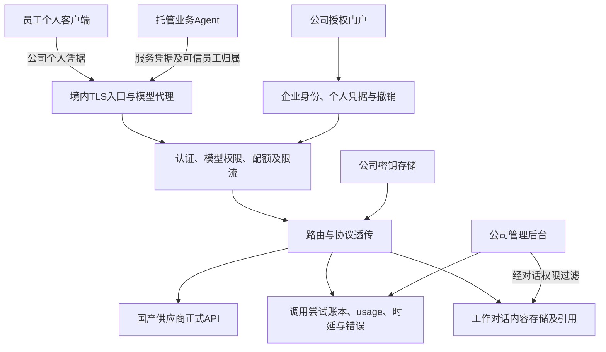

> 历史设计快照，冻结于 2026-10-26 范围调整前。公司模型代理、个人授权、用量和公司对话管理已移出本项目，以下任务编号、依赖和候选说明仅用于历史追溯，不属于本项目当前范围或待办。

# 公司国产模型代理、个人授权与对话管理方案

版本：1.0｜更新日期：2026-10-26｜对应产品基线：[01](../01-需求规格.md) 2.0｜任务：K21–K22。

本文为境内部署和国产模型使用方案，尚未采购、发放凭据或部署；New API 与 Higress 为模型代理候选，具体留到相关开发启动时按 K24 验证。只规划中国模型供应商及中国境内服务；Codex 是员工可选客户端，使用它不要求采购或调用国外模型。本方案不以 GPT 或其他美国模型为上游。

## 1. 产品目标和管理范围

公司统一采购国产供应商正式 API 账户及用量，统一保管上游密钥，对员工提供公司模型端点和个人授权。员工继续使用自己的 WorkBuddy、Codex 或 DeepSeek Harness，公司按员工、部门、应用、项目和模型统计流量，并管理经代理传输的公司业务对话。

采购账户、个人授权、资源权限和对话权限分别管理：公司采购账户证明公司可调用某供应商；个人授权决定员工可用模型和额度；知识/客户/仓库权限决定可读资源；对话权限决定可看哪些已归档内容。任一权限不能代替另外三种。

首期交付一个国产供应商、一种协议和一个客户端的闭环，再增加第二协议、其他客户端和国产供应商。首期模型候选以 DeepSeek `deepseek-flash` 为起点；具体上游版本、图片、工具、上下文、搜索及参数能力通过目录和实测登记，不从模型名推定。

## 2. 总体结构与部署



模型代理候选包括 New API 和 Higress；两者各自可复用的网关能力与需要补齐的企业身份、组织归属、客户端配置和策略接口见 [06](2026-10-26-开源Agent与模型代理候选清单.md)。New API 不假定可保存 prompt 正文；托管 Agent 对话由 Agent 服务/业务系统管理，个人客户端正文归档是独立缺口。实际开发启动时再结合协议、身份、许可、国产上游和客户端版本选型。Agent 框架候选为 AgentScope 与 LangGraph。

各供应商适配器声明上游 URL、协议、允许参数、模型映射、能力、错误/usage 规范化。优先原生 Chat Completions 和 Responses 透传，保留必要工具/消息标识，不将两种协议视为简单字段改名。未来确需协议转换时单独建任务与兼容测试，未实现前不接入不兼容组合。

服务、数据库、内容日志、对象存储、备份和观测系统规划部署在公司选定的中国境内云资源。模型出口仅配置获准国产供应商域名；失败不自动路由境外模型。客户端自己的登录、更新、插件或遥测与推理流量分开核对；使用公司模型代理不自动证明某客户端所有网络活动都留在境内。

## 3. 公司采购账户与模型目录

上游使用公司正式 API 服务凭据。采购额度、套餐或账户类型按供应商可用 API 权益登记，网页聊天账号、个人订阅或登录 cookie 不能自动当成可转发给全公司的 API 额度。

模型目录记录公司别名、供应商、实际模型/版本、境内接入点、可用协议、输入类型、工具/结构化输出、上下文与输出限制、推理参数、联网能力、计费配置版本及验收日期。对外可列“公司通用模型”“公司推理模型”等别名，但请求账本必须记录实际供应商和路由版本，能解释同一别名在不同时期的行为。

首期供应商为 DeepSeek；通义、智谱、Kimi 等国产供应商仅作为后续适配对象，不表示公司已开通或完成兼容验证。模型价格、限流和可用范围从实际采购与官方配置维护，不在需求文档固化未经核实数值。

embedding、重排、图片理解、语音和联网检索分别登记。只有具备相应能力的获准模型可以接到任务；不能把文本模型补上 `supportsImages` 就当成多模态。embedding 模型/维度/索引版本固定，不能跟普通推理模型一起做随机切换。

上游密钥仅由服务器密钥存储引用，员工只获得公司个人凭据。密钥轮换不中断已确认的账本归属，旧供应商凭据可撤销；日志不保存明文 key、Authorization 或刷新令牌。

## 4. 企业身份与个人授权

用户通过企业身份登录公司授权门户，确认员工/部门和获准模型范围。首期支持服务端签发有期限、可撤销、可轮换的个人 API 凭据，供没有公司 SSO 集成能力的客户端配置；后续可加入兼容客户端的短期 OAuth/OIDC 授权。不能假设三种客户端都支持同一授权页面或自动刷新。

个人凭据至少绑定 `employee_id`、`credential_id`、允许客户端/用途、模型范围、部门、有效期、配额、速率及内容留存策略；数据库仅存安全摘要和必要展示指纹。个人可有多个设备/客户端凭据，额度归属到同一员工。管理员可限制、轮换、撤销，员工离职或权限变更后服务端立即按配置生效。

请求中的 user、部门、项目或会话等自报字段不能改变凭据所属员工。公司代理从可信授权记录计算员工归属；项目计费需要校验该员工的项目范围。托管 Agent 使用独立服务凭据和可信代用户上下文，普通个人 key 不能通过伪造请求头冒充他人或绕过限额。

个人凭据只授予模型调用。访问知识 MCP、销售库或仓库需各自资源授权；模型代理不会因某人付费或有额度而授予项目数据。

## 5. 客户端协议与接入矩阵

以下官方资料在 2026-10-26 查阅，仅证明存在可配置的集成路径，不代表公司代理和用户当前客户端已联调通过。

| 客户端 | 官方资料所示路径 | 公司接入规划 | 尚需实测 |
| --- | --- | --- | --- |
| WorkBuddy/CodeBuddy | DeepSeek 集成指南示例使用自定义模型文件和完整 Chat Completions URL | 公司 `/v1/chat/completions` 与个人凭据 | 实际 OS/版本配置位置、环境变量展开、流式、工具回传、图片与会话标识；官方示例为 Windows，不直接推断 macOS 路径 |
| Codex | 自定义 provider；`base_url`、`env_key`，当前官方 `wire_api` 为 Responses；DeepSeek 提供 Codex 接入指南 | 公司 `/v1/responses` 与国产上游原生 Responses 路由 | 使用中的 CLI/桌面/扩展版本、目录元数据、工具事件、断流、压缩/恢复；不能用仅支持 Chat Completions 的路由冒充兼容 |
| DeepSeek Harness | Custom model API 可配置公司端点、凭据和协议 | 先验证 Chat Completions 或 Responses 中的一种，再扩展 | 安装版本、模型目录、推理参数、工具/图片、凭据更新与会话关联；预览版行为需固定版本 |

“API 采用兼容协议”描述报文形态，不表示调用国外服务。公司实际转发只选国内模型供应商。非原生协议能力不默认通过通用转换补齐。

### 5.1 规划的 HTTP 面

| 路由 | 状态 | 契约 |
| --- | --- | --- |
| `GET /v1/models` | 待开发 | 仅返回个人有权使用且已准入的模型/能力别名 |
| `POST /v1/chat/completions` | 待开发 | 转发至已验证国产 Chat Completions 上游，支持已验收字段与 SSE |
| `POST /v1/responses` | 待开发 | 转发至国产原生 Responses 上游；工具、事件、响应引用与可能的后续读取端点按客户端实测补齐 |
| embedding 等能力入口 | 后续按需 | 独立模型与配额，不能暗中替换现有索引模型 |
| 授权、凭据、目录、配额、报表和会话管理 API | 待开发 | 管理面单独授权；客户端 key 默认不能管理公司账户或查看他人内容 |

公司示例地址统一使用 `https://llm.company.example`，仅作占位，不是已存在服务。不同客户端填写完整 URL 或 base URL 的方式不同，要由配置生成器给出版本对应的模板，避免重复 `/v1`。

### 5.2 Codex 配置示意

以下仅展示公司 provider 的关系，不修改个人配置，不代表当前客户端全部支持；模型目录/能力等附加配置以实测版本确定。

```toml
model_provider = "company_cn"
model = "company-general"

[model_providers.company_cn]
name = "公司国产模型"
base_url = "https://llm.company.example/v1"
env_key = "CORP_MODEL_TOKEN"
wire_api = "responses"
```

`CORP_MODEL_TOKEN` 是员工个人的公司凭据，上游公司采购 key 不进入配置。WorkBuddy 按实际版本使用完整 Chat Completions URL；Harness 选择与该公司路由一致的协议，不复制 Codex 字段。

## 6. 一次模型请求的处理

1. 校验 TLS、个人/服务凭据、有效期和员工状态，生成可信 request/trace ID。
2. 根据凭据和权限选模型别名、实际供应商及路由版本，检查上下文/图片/工具等能力是否准入。
3. 按员工、部门、应用和模型执行配额/限流，必要时预留估算额度，避免多个并发请求同时突破预算。
4. 创建逻辑请求和调用尝试账本，绑定真实员工、项目与留存策略；客户端字段只作为已校验的辅助关联。
5. 从服务器密钥存储取得供应商凭据，按已验证协议转发；个人公司凭据不泄露给供应商。
6. 流式转发保留消息/工具 ID 与事件顺序；记录首 token、结束、取消或断流，不把收到首个片段当请求完成。
7. 保存供应商返回的 usage 与实际模型；内容根据凭据策略留存，元数据和正文分别授权。
8. 结算额度，保存估算/实际/待核对状态和上游请求标识，供后续对账。

重试按调用尝试独立记账。客户端重试可能造成新的供应商计费，不能仅按客户端 request_id 假定只计一次。开始返回流或可能已执行工具后，不静默重放；无法确认用量的断流记录待核对，不填零。供应商限流、无余额、模型不兼容、认证失效和内部错误分别返回清晰状态。

故障切换只在获准、同协议、同必要能力的国产模型路由间执行，并保留原请求与实际路由；需要保持推理语义或工具状态时直接失败，不偷偷换低能力模型续写。工具在客户端或业务 Agent 执行，模型代理不自行执行工具调用。

## 7. 用量、费用和管理分析

原始计量按供应商、模型版本和返回 usage 保存，再标准化输入/输出/缓存 token、请求/尝试次数、工具/搜索等供应商单列费用、时延和状态。不同供应商单位和缓存口径不可直接合并成“统一 token 单价”。

账本至少包含 employee/team/app/project、credential 指纹、client 类型、逻辑 request_id、attempt_id、供应商 request_id、模型别名/实际模型、协议、route_version、token 分类、计费规则版本、货币、估计费用/供应商账单费用、结算状态和时间。

管理视图包括个人/团队/应用/模型用量，配额使用、失败与限流、首 token 和完成延迟、重复重试、缓存使用、异常使用和费用趋势。以供应商实际账单对账；本地估算不能称为已扣款。模型请求次数不作为销售沟通次数，不能以 token 量直接推定员工产出质量。

## 8. 公司业务对话管理

### 8.1 可管理内容与覆盖边界

公司代理能看到实际经过其传输的请求、响应与供应商返回字段。客户端可能重复发送历史、截断/摘要上下文、隐藏会话 ID 或只发送文件片段；代理无法因此获得完整本地线程、所有附件、全部工具执行或未传输历史，也不声称读取模型隐藏推理。

公司自建 Agent 有完整业务运行记录，可以形成可追溯任务轨迹。个人客户端模式分为“请求级审计”和“客户端协作的会话级归档”：没有稳定会话/消息标识时保留请求记录和覆盖状态，不能按相似文本推断为完整会话。需管理本地工具执行时，另做客户端运行事件集成，不通过模型请求猜测执行结果。

### 8.2 内容与元数据的存储策略

用量元数据按公司模型调用强制记账；公司工作凭据可配置工作对话正文留存、分类、检索和回链，员工使用前能看到对应策略。仅计量凭据只保留元数据；是否允许该类凭据由公司业务配置确定，不能由客户端任意参数关闭强制工作归档。保留周期和访问角色在启用内容归档前配置，不在本文虚构天数。

原始模型报文与整理后的对话视图分开。原始报文只保留业务需要且允许存储的字段，凭据和认证信息删除/屏蔽；会话视图对历史重复上下文按消息 ID、内容摘要与顺序去重，并保留原始引用。相同文本不自动认定同一消息。断流、缺消息、工具轨迹缺失和仅摘要状态均显示覆盖缺口。

正文按本人、资源业务负责人、获准审计人分别过滤；管理模型额度的人默认只看元数据，正文查询/导出另授权限并留访问记录。跨员工、客户或项目的会话检索先在服务端限定范围，再进入语义检索/摘要。

### 8.3 会话归属、分析与业务记录

公司 Agent 自动绑定已确认商机/项目和 run ID；个人客户端能提供稳定 ID 时，经服务校验后关联。无法确定业务归属保留“未分配”，允许本人补充；不按模型猜测公司名称就自动关联客户。

管理功能可包括会话检索、项目分类、脱敏摘要、问题/需求候选提取、知识缺口和工具失败分析。模型提取结果标候选，不能直接更新商机阶段、形成客户承诺或计入销售沟通。转销售记录必须经过 K15.2 的来源映射和销售确认。

对话内容修订/撤回、资源权限变化和保留期到期，应同步到对话索引、缓存和访问视图，保留必要元数据与删除/撤回审计。日志/对话库与公司公共 RAG 分开，不能把公司所有工作对话自动公开入库。

## 9. 分期实施与验收

| 阶段 | 看板 | 交付 | 必要验收 |
| --- | --- | --- | --- |
| G1 目录与采购边界 | K21.1 | 国内供应商、正式 API、能力/价格配置和境内部署范围 | 实际账户权益及密钥引用；不在源码中留真实凭据 |
| G2 个人授权与单协议 | K21.2 | 员工凭据、撤销轮换、一个模型和单客户端基础调用 | 两个用户归属隔离、无效 key、禁用员工、配额并发、流式与取消 |
| G3 原生协议与多客户端 | K21.3–K21.5 | Responses/Chat 路由、WorkBuddy/Codex/Harness 配置模板 | 按客户端/OS/版本/模型/协议组合做文本、多轮、工具、图片、断流和恢复验收；不支持能力明确关闭 |
| G4 用量与对账 | K22.1 | 请求/尝试账本、部门配额和统计 | 缓存口径、重试/断流、估算与账单差异，个人不能改归属 |
| G5 工作对话管理 | K22.2–K22.3 | 正文策略、权限视图、分类和覆盖标记 | 重复上下文去重、缺失会话 ID、跨员工/项目访问、撤回/保留期和访问审计 |
| G6 运营与可靠性 | K21.6 / K22.4 | 供应商扩展、监控、备份恢复、故障演练 | 国内路由限制、配置回退、密钥轮换、幂等记账和恢复后权限一致 |

选定网关候选后，可在对应开发迭代中单独验证，不意味着暂停中的公司知识生产适配 K16 已完成。公司多用户业务 Agent 正式上线仍要验证其知识/文件/身份链；个人模型代理可以独立于 RAG 使用。

## 10. 官方资料与证据边界

查阅日期：2026-10-26。以下用于协议与客户端路径规划，公司服务尚未联调。

- [DeepSeek API 与 Agent 集成](https://api-docs.deepseek.com/quick_start/agent_integrations/)：国产模型 API 及官方客户端指引入口。
- [DeepSeek 的 WorkBuddy/CodeBuddy 指引](https://api-docs.deepseek.com/quick_start/agent_integrations/workbuddy/)：自定义 Chat Completions 端点；需核对安装版本与平台。
- [DeepSeek 的 Codex 指引](https://api-docs.deepseek.com/quick_start/agent_integrations/codex/)：国产上游 Responses 路径；公司代理只是规划，不能等同于直连测试结果。
- [Codex 官方配置参考](https://developers.openai.com/codex/config-reference/)：自定义 provider、base_url、env_key 和 Responses 配置；这里只参考客户端协议，不采用美国模型。
- [DeepSeek Harness 模型配置](https://deepseek-harness.github.io/deepseek-harness/en/guide/providers)：自定义公司端点与协议，配置声明仍需请求验证。

## 9. 开源代理候选及正文边界

New API 在模型路由、个人 API key、模型权限、配额和调用用量日志方面有现成能力；可与 Higress 比较，避免在最终选型前重复开发通用代理控制台。公开使用日志覆盖模型、用户、key、token、时延、费用及错误等字段；它不等于可搜索的完整工作对话。New API 仓库对 prompt 记录的公开功能请求为关闭/未计划，故 K22.2–K22.3 不得标记为开箱即用。个人客户端的完整输入/输出留存仍需独立适配评估；托管 Agent 由 Agent 服务保存具有业务身份和权限的会话/事件。AGPL-3.0 许可义务核查列为部署前的技术准入事项。详细来源及其他网关对比见 [06](2026-10-26-开源Agent与模型代理候选清单.md)。
